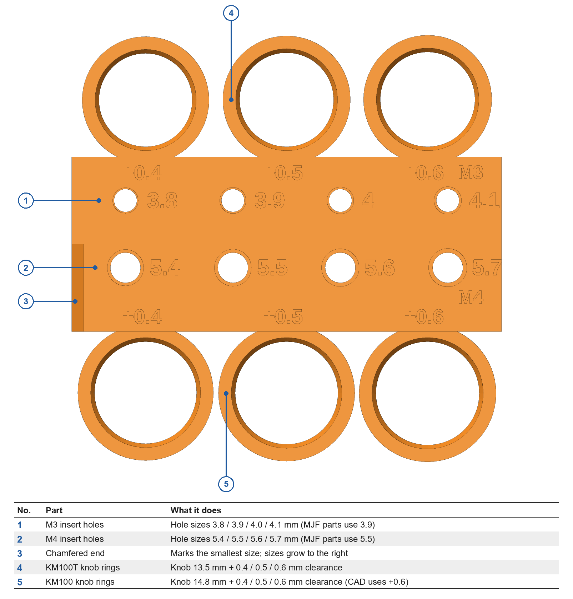

# Stage 1: 3D Printing

Learn the lab FDM printer and the slicer, then print the mirror-fitting test print.

## Mirror-fitting test print

File: [`MIR_fit_coupon_v1.stl`](../2-cad-and-fit/stl/MIR_fit_coupon_v1.stl)

A small plate with two features:

- **Rings** in three sizes that slide over the mirror mount's adjuster knobs, one row for the KM100 and one for the KM100T. The ring that fits the real knob best sets the bore of the printed knob caps.
- **Holes** in four sizes for M3 and M4 heat-set inserts. The size that holds an insert firmly sets the insert holes in every printed part.

Printers make holes slightly smaller and edges slightly larger than the CAD, so these sizes are found by testing on this printer rather than taken from the drawing. The results become the starting values for [Stage 2](../2-cad-and-fit/README.md).
