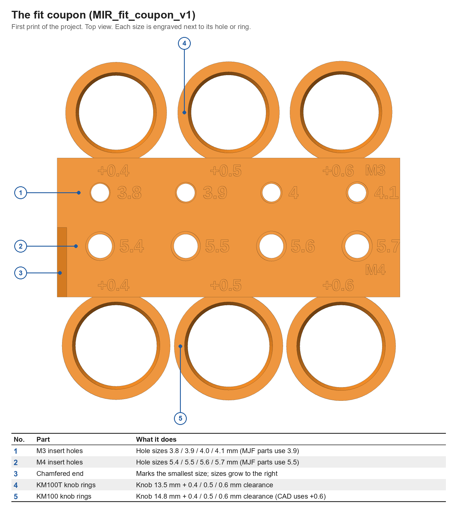

# Stage 1: 3D printing and the fit coupon

**Scope:** operate the lab FDM printer and slicer, measure printed parts to about 0.1 mm, and set heat-set inserts.
Printer, filament and the printer safety walk-through are arranged with Cameron Grant.

**Inputs:** [`MIR_fit_coupon_v1.stl`](../2-cad-and-fit/stl/MIR_fit_coupon_v1.stl), a 20 mm calibration cube, calipers, M3 and M4 heat-set inserts (McMaster 94459A130, 94459A150), a KM100 or KM100T mount.

**Output:** a completed fit-coupon table (below) recorded in the lab notebook.

**Done when:** a calibration cube and the fit coupon have been printed and measured, inserts have been set in the coupon, and the table is filled in and reviewed with Cameron Grant.

## Topics covered

| Topic | Reference values |
|---|---|
| Slicer settings | 0.2 mm layers, 3-4 perimeters, 30-40 % infill, no supports; brim if corners lift |
| Calibration cube | 20 mm cube; X, Y, Z within 0.1-0.2 mm of 20.00 is typical |
| FDM tolerances | Holes print undersize, outside edges oversize; first-layer spread ("elephant's foot"). Fits are therefore tested, not assumed from CAD. |
| Heat-set inserts | Flat or insert tip; insert pressed in square under light load until flush, then flattened with a cool flat tool. Temperature: lab setting for the filament; 230-245 °C for the final nylon parts per the design notes. Iron used in its stand, in a ventilated area. |

## Fit coupon

[`MIR_fit_coupon_v1.stl`](../2-cad-and-fit/stl/MIR_fit_coupon_v1.stl) is a flat plate with graded M3 and M4 insert holes and graded rings that slide over the mount's adjuster knobs. It prints flat without supports.

| Measurement | Method | Selection criterion |
|---|---|---|
| Hole sizes | Inside jaws of the calipers, compared with the engraved value | - |
| Insert holes | One M3 insert per M3 hole, one M4 insert per M4 hole | Smallest hole where the insert sits square, ends flush, and does not spin when a screw is tightened by hand with a short hex key |
| Knob rings | Each ring pushed over an adjuster knob of the real mount | Ring that slides on by hand with the least play |

Results table:

| Feature | Sizes on the coupon (mm) | Measured hole sizes | Best size |
|---|---|---|---|
| M3 insert hole | 3.8 / 3.9 / 4.0 / 4.1 | | |
| M4 insert hole | 5.4 / 5.5 / 5.6 / 5.7 | | |
| Knob ring (mount used) | +0.4 / +0.5 / +0.6 | | |

## FDM test prints versus final MJF parts

Final parts are ordered from JLC3DP in MJF PA12 nylon. The lab FDM printer is used for fast, inexpensive test prints during fitting.

The two processes size holes differently. Current CAD values (MJF): M3 insert hole 3.9 mm, M4 insert hole 5.5 mm. Earlier FDM test prints used 4.0 mm and 5.6 mm; these are the FDM starting point, to be confirmed by the coupon results.

The values are `ins3_d` and `ins4_d` in [`attachment_params.scad`](../2-cad-and-fit/cad/attachment_params.scad), lines 252-253. FDM values are kept in the notebook; the MJF values are restored before the final order (see [Stage 3](../3-parts/README.md)).

Next: [Stage 2](../2-cad-and-fit/README.md).
