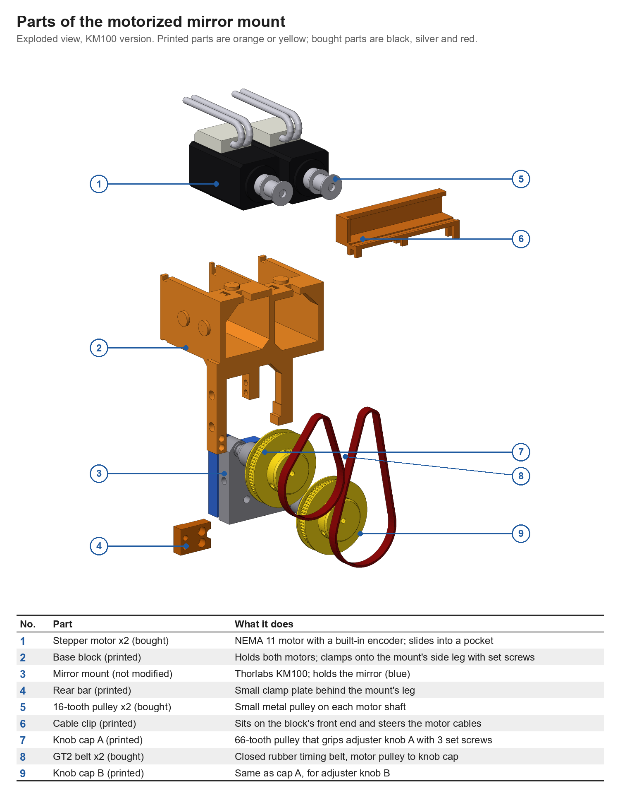
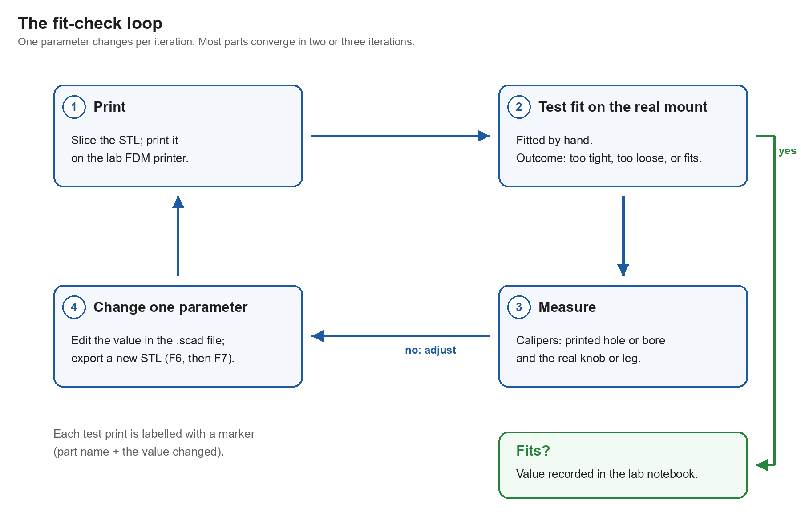
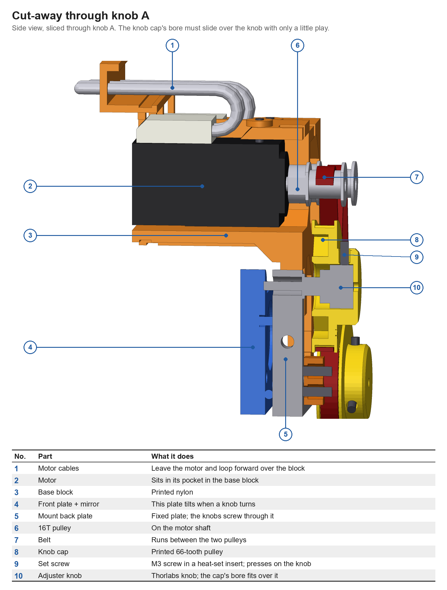
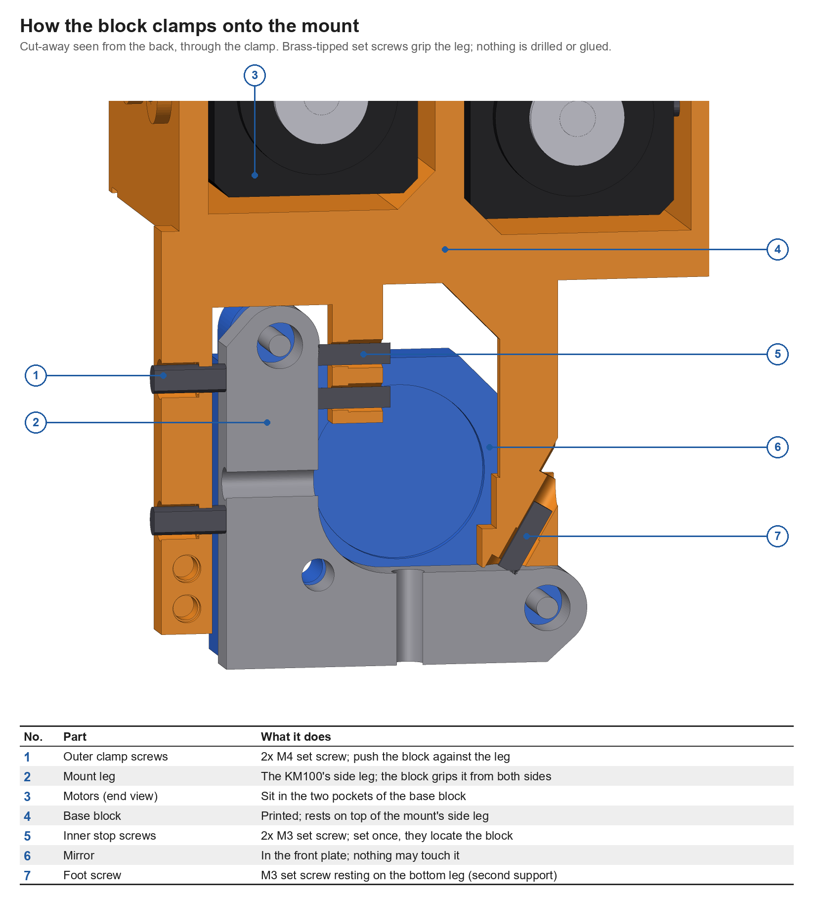

# Stage 2: fit the printed parts to a real mount

**Scope:** iterate print, test fit, measure and adjust until every printed part fits the target mirror mount.

**Inputs:** Stage 1 coupon results; the target mount (see [mounts](mounts/README.md)); the OpenSCAD source in [`cad/`](cad/); the lab FDM printer.

**Output:** FDM test parts that fit, a log of every parameter change, and caliper measurements of the real mount.

**Done when:** the knob caps and the base block fit the target mount by the criteria below, and the parameter log has been reviewed with Cameron Grant.

Printed parts: base block, rear bar, knob caps A and B, cable clip. The motors, 16-tooth pulleys and belts are bought (Stage 3).

## Target mount

The KM100 is the reference mount. The KM100T uses the same base block and rear bar with its own knob caps. The Radiant Dyes MDI-2-3025-M6 is provisional and not ready to print. Details: [mounts/README.md](mounts/README.md).

## Folder contents

| Path | Contents |
|---|---|
| [`cad/`](cad/) | OpenSCAD source, v4.1. The files include each other and stay in one folder. Conventions: [CONVENTIONS.md](cad/CONVENTIONS.md). |
| [`stl/`](stl/) | Print-ready STLs generated from that source |
| [`mounts/`](mounts/README.md) | Models of the mirror mounts (for viewing and checks, not for printing) |
| [`cad/extras/`](cad/extras/README.md) | Interference checks |

| STL in `stl/` | Part | Quantity per mount |
|---|---|---|
| `MIR_fit_coupon_v1.stl` | Fit coupon (Stage 1) | 1 |
| `knob_extension_A_KM100_v4.stl`, `knob_extension_B_KM100_v4.stl` | Knob caps A and B, KM100 | 1 each |
| `knob_extension_A_KM100T_v4.stl`, `knob_extension_B_KM100T_v4.stl` | Knob caps A and B, KM100T | 1 each |
| `attachment_bracket_v4.stl` | Base block (block, clamp and post in one piece) | 1 |
| `rear_bar_v4.stl` | Rear bar | 1 |
| `MIR_cable_clip_v1.stl` | Cable clip | 1 |

Print order, smallest to largest: coupon, knob caps, base block, rear bar and clip.

## OpenSCAD

The lab uses OpenSCAD 2021.01; newer versions also work. F5 previews, F6 renders (several minutes for the base block), F7 exports STL. Test exports carry a descriptive suffix, e.g. `knob_extension_A_KM100_FDMtest2.stl`.

| Part | File in `cad/` | Selector (top of file) |
|---|---|---|
| Fit coupon | `fit_coupon.scad` | none |
| Knob cap A or B | `knob_extension.scad` | `which = 0` (A) or `1` (B) |
| Base block | `attachment_bracket.scad` | `part = "block"` |
| Cable clip | `attachment_bracket.scad` | `part = "cable_clip"` |
| Rear bar | `attachment_parts.scad` | `only = "rear_bar"` |
| Full assembly on the mount (view only) | `assembly.scad` | `exploded = true` for an exploded view |

## Adjustable parameters

These are the parameters expected to change during fitting. One parameter changes per iteration, and each change is logged. Other parameters stay fixed unless agreed with Cameron Grant, because the block geometry has been collision-checked against the mount.

| Parameter | File and line (in `cad/`) | Controls | Current (MJF) | FDM test prints |
|---|---|---|---|---|
| `mount_type` | `mount_params.scad`, line 16 | Mount the caps are generated for | `"KM100"` | same |
| `knob_d` | `mount_params.scad`, line 32 (KM100) or 71 (KM100T) | Real knob diameter; estimated from drawings, to be measured | 14.8 / 13.5 | caliper value |
| `kx_bore_clr` | `attachment_params.scad`, line 111 | Diametral clearance of the cap bore on the knob | 0.6 | best coupon ring (0.4-0.6) |
| `ins3_d`, `ins4_d` | `attachment_params.scad`, lines 252-253 | M3 and M4 heat-set insert hole diameters | 3.9 / 5.5 | 4.0 / 5.6, or coupon result |
| `kp_add_w` | `attachment_params.scad`, line 114 | Tooth-gap widening on the printed 66-tooth pulley | 0.1 | 0.2 |
| `pk_clr` | `attachment_params.scad`, line 177 | Clearance per side around each motor in its pocket | 0.15 | 0.2-0.25 if the motor does not slide in |

## Fit-check loop

Fit criteria:

| Part | Fits when |
|---|---|
| Knob cap | Slides onto the knob by hand with slight play; three M3 x 8 set screws centre and hold it; a GT2 belt seats in the teeth without riding up |
| Base block | Rests on the mount's side leg; clamp screws reach the leg from both sides; the mirror tilts freely; nothing touches the mirror or the front plate |
| Rear bar and cable clip | Align with the block's holes and grooves without force |

Parts are not hand-filed to fit; the parameter is corrected so that the next print fits as well. Test prints are labelled with part, changed value and date.

## Mount measurements

The mount models come from manufacturer drawings, so some dimensions are estimates. Measured on the real mount with calipers: knob diameter (across the knurl crests), knob protrusion behind the back plate, side-leg width. A deviation of more than 0.2 mm from `mount_params.scad` is reviewed with Cameron Grant before the value is changed, since the interference checks ([`cad/extras/`](cad/extras/README.md)) may need to be re-run.

Next: [Stage 3](../3-parts/README.md).
