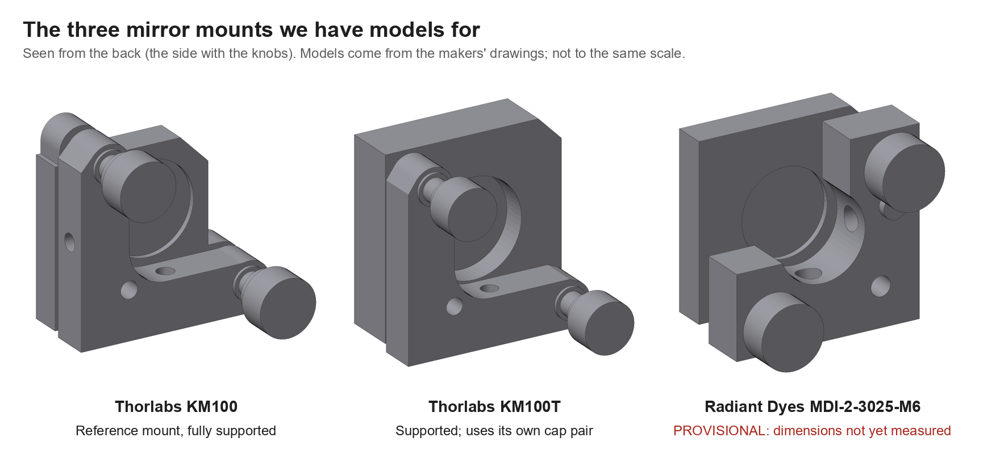

# Mirror mount models

| Mount | Maker | Manufacturer page | Status |
|---|---|---|---|
| KM100 | Thorlabs | [thorlabs.com/item/KM100](https://www.thorlabs.com/item/KM100) | Reference. Base block designed on this mount. Caps: `knob_extension_{A,B}_KM100_v4.stl`. |
| KM100T | Thorlabs | [thorlabs.com/item/KM100T](https://www.thorlabs.com/item/KM100T) | Supported. Same base block and rear bar; own cap pair: `knob_extension_{A,B}_KM100T_v4.stl`. |
| MDI-2-3025-M6 | Radiant Dyes | [radiant-dyes.com, MDI mirror mount](https://www.radiant-dyes.com/index.php/products/optomechanics/mirror-mounts/125-mdi-mirror-mount) | Provisional. The lab owns one. Model derived from a low-resolution drawing (about ±0.5-1 mm); dimensions pending measurement. See [mdi-provisional](mdi-provisional/README.md). |

## Files

| File | Contents |
|---|---|
| [`mirror_mount.scad`](mirror_mount.scad), [`mount_params.scad`](mount_params.scad) | Parametric mount models. Mount selected on line 16 of `mount_params.scad` (`"KM100"`, `"KM100T"` or `"MDI-2-3025-M6"`). |
| [`mirror_mount_KM100.stl`](mirror_mount_KM100.stl), [`mirror_mount_KM100T.stl`](mirror_mount_KM100T.stl) | Mount models as STL, for viewing (GitHub renders STLs in the browser) |
| [`mdi-provisional/`](mdi-provisional/README.md) | MDI mount model, provisional attachment parts, measurement sheet |

The mount models are reference geometry, not printable parts.

The two `.scad` files here are copies of those in [`../cad/`](../cad/). The attachment parts read [`../cad/mount_params.scad`](../cad/mount_params.scad); that copy is authoritative for mount dimensions.

## KM100 versus KM100T

The KM100 holds an unthreaded 1-inch optic, retained by a nylon-tipped screw. The KM100T has a thicker, SM1-threaded front plate.
