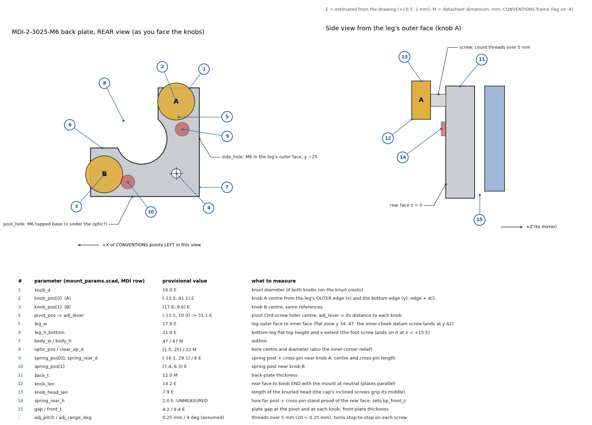

# Radiant Dyes MDI-2-3025-M6 (provisional)

**Status: provisional. Nothing in this folder is to be printed or ordered until the mount has been measured and the parts regenerated.**

The lab owns one MDI-2-3025-M6. Its model and the attachment parts derived from it come from a low-resolution drawing and may be off by 0.5-1 mm. The MDI is mirror-imaged relative to the KM100: its side leg and knob A are on the opposite side.

## Plan

Measure every numbered item on the sheet, enter the values in the `MDI-2-3025-M6` row of [`../../cad/mount_params.scad`](../../cad/mount_params.scad), regenerate the parts and re-run the interference checks. Test printing follows after that.

## Files

| File | Contents |
|---|---|
| `MDI_measurement_sheet.png` | Numbered measurement list with current estimates |
| `mirror_mount_MDI-2-3025-M6_PROVISIONAL.stl` | Model of the mount (view only) |
| `attachment_bracket_MDI_PROVISIONAL.stl` | Provisional base block; not for printing |
| `rear_bar_MDI_PROVISIONAL.stl` | Provisional rear bar; not for printing |
| `knob_extension_A_MDI_PROVISIONAL.stl`, `knob_extension_B_MDI_PROVISIONAL.stl` | Provisional knob caps (52-tooth pulleys, angled set screws); not for printing |
