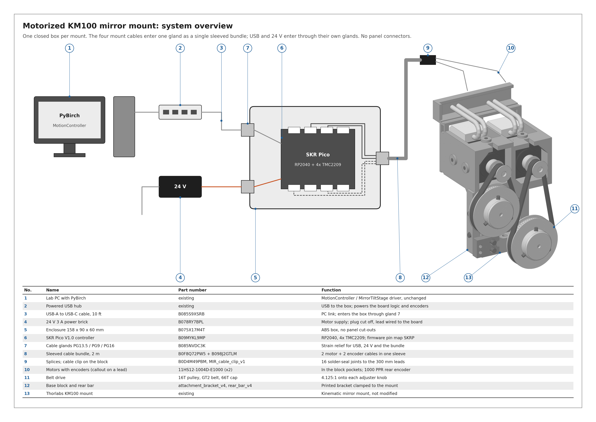

# Stage 3: Electronics & Purchasing

One motorized mount and one controller box. Prices are approximate (late 2026).

## Parts

| Item | Purpose | Link | Qty | Approx. price |
|---|---|---|---|---|
| NEMA 11 stepper with encoder, 11HS12-1004D-E1000 | Drives one knob; encoder counts its steps | [StepperOnline](https://www.omc-stepperonline.com/nema-11-closed-loop-stepper-motor-0-06nm-8-5oz-in-encoder-1000ppr-4000cpr-11hs12-1004d-e1000) | 2 | ~$50 each |
| GT2 16-tooth pulley, 5 mm bore, 5-pack | Pulley on each motor shaft | [Amazon B07BT6DPX7](https://www.amazon.com/dp/B07BT6DPX7) | 1 pack | ~$8 |
| GT2 closed belt 158 mm, 6 mm wide, 5-pack | Belt for knob A | [Amazon B0FRDQ7K8F](https://www.amazon.com/dp/B0FRDQ7K8F) | 1 pack | ~$7 |
| GT2 closed belt 220 mm, 6 mm wide, 5-pack | Belt for knob B | [Amazon B0GVKJ3SVF](https://www.amazon.com/dp/B0GVKJ3SVF) | 1 pack | ~$8 |
| BIGTREETECH SKR Pico V1.0 | Controller: drives the motors, reads the encoders | [Amazon B09MYKL9MP](https://www.amazon.com/dp/B09MYKL9MP) | 1 | ~$36 |
| 24 V 3 A power adapter | Motor power | [Amazon B078RY7BPL](https://www.amazon.com/dp/B078RY7BPL) | 1 | ~$18 |
| Plastic enclosure 158 x 90 x 60 mm | Houses the board | [Amazon B075X17M4T](https://www.amazon.com/dp/B075X17M4T) | 1 | ~$7 |
| USB-A to USB-C cable, 10 ft | Board to lab PC | [Amazon B085S9XSRB](https://www.amazon.com/dp/B085S9XSRB) | 1 | ~$9 |
| Cable gland kit | Cable entry into the box | [Amazon B085NVDC3K](https://www.amazon.com/dp/B085NVDC3K) | 1 kit | ~$7 |
| M3 nylon standoff kit | Board standoffs | [Amazon B0F297R23T](https://www.amazon.com/dp/B0F297R23T) | 1 kit | ~$9 |
| 2 m stepper cables (XH2.54), 6 pcs | Box-to-motor cables, pre-crimped | [Amazon B098J2GTLM](https://www.amazon.com/dp/B098J2GTLM) | 1 pack | ~$13 |
| XH2.54 connector kit | Re-pinning the encoder cables for the board | [Amazon B0BPRQBTGY](https://www.amazon.com/dp/B0BPRQBTGY) | 1 kit | ~$16 |
| Solder-seal wire splices | Cable-to-motor-lead joints | [Amazon B0D4M49PBM](https://www.amazon.com/dp/B0D4M49PBM) | 1 pack | ~$7 |
| Braided cable sleeve | Bundles the four cables | [Amazon B0F8Q72PW5](https://www.amazon.com/dp/B0F8Q72PW5) | 1 | ~$11 |
| Marker-tag cable ties | Labels at both ends of each cable | [Amazon B07DNXKVVK](https://www.amazon.com/dp/B07DNXKVVK) | 1 pack | ~$10 |
| Heat-shrink tubing kit | Covers the splices | [Amazon B01MFA3OFA](https://www.amazon.com/dp/B01MFA3OFA) | 1 kit | ~$8 |
| M3 brass heat-set inserts, 50-pack | Threads in the printed parts | [McMaster 94459A130](https://www.mcmaster.com/94459A130) | 1 pack | ~$11 |
| M4 brass heat-set inserts, 50-pack | Threads for the clamp screws | [McMaster 94459A150](https://www.mcmaster.com/94459A150) | 1 pack | ~$11 |
| M3 x 8 cup-point set screws, 100-pack | Motor tension, motor lock, knob caps | [McMaster 91390A101](https://www.mcmaster.com/91390A101) | 1 pack | ~$7 |
| M4 x 10 brass-tip set screws, 5-pack | Clamp screws (brass tip avoids marking the mount) | [McMaster 90418A234](https://www.mcmaster.com/90418A234) | 1 pack | ~$16 |
| M3 x 10 brass-tip set screws, 5-pack | Inner stop screws and foot screw | [McMaster 90418A111](https://www.mcmaster.com/90418A111) | 1 pack | ~$16 |
| M3 x 12 socket head screws, 100-pack | Rear bar to block | [McMaster 91292A114](https://www.mcmaster.com/91292A114) | 1 pack | ~$7 |
| Metric hex key set, 1.5-10 mm | All screws in the kit | [McMaster 5511A41](https://www.mcmaster.com/5511A41) | 1 | ~$7 |
| Printed parts, MJF PA12 nylon | Final base block, rear bar, knob caps, clip, test print | [JLC3DP](https://jlc3dp.com) | 1 set | ~$75 with shipping |

Approximate total: about $425 for one mount and its box, before tax.

## Printed-parts order

- MJF hole sizes in the CAD (M3 insert 3.9 mm, M4 insert 5.5 mm), not the FDM test values.
- Measured knob diameter entered in [`mount_params.scad`](../2-cad-and-fit/cad/mount_params.scad) and the caps re-exported.
- Only the cap pair for the target mount (KM100 or KM100T).
- JLC3DP order note: no bead-blasting or smoothing of the pulley teeth on the knob caps.

## Electronics overview

The full electronics description (box internals, panel drilling, wiring at the mount) is in [`system-overview.pdf`](system-overview.pdf). Its figures are also available as PNGs:

| Figure | Contents |
|---|---|
| [`fig1_system_overview.png`](fig1_system_overview.png) | System overview |
| [`fig2a_box_internals.png`](fig2a_box_internals.png) | Box internals |
| [`fig2b_box_panels.png`](fig2b_box_panels.png) | Box panels and drilling |
| [`fig2c_mount_end.png`](fig2c_mount_end.png) | Wiring at the mount |

Estimated box build time once parts arrive: about 30 minutes.

Next: [Stage 4](../4-automation/README.md).
