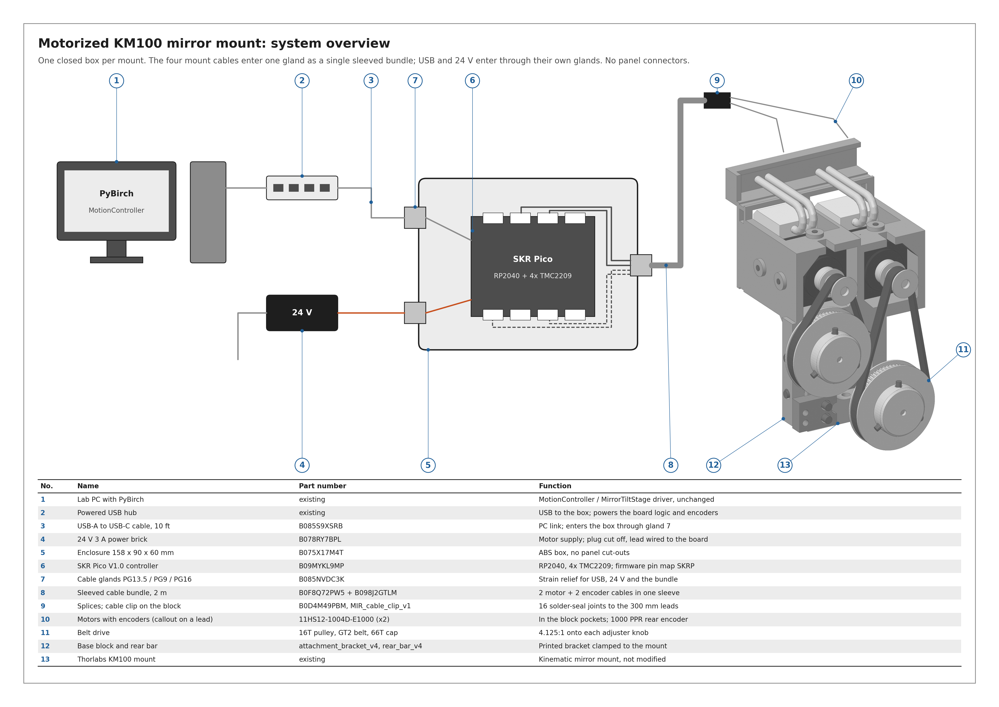

# Stage 4: automation software

**Scope:** bring up the controller box and drive the mirror from the lab PC, first in simulation and then on hardware.

**Inputs:** the lab's `05_PyBirch_Drivers` folder (copy available from Cameron Grant); an assembled controller box and motorized mount from Stage 3 for the hardware part.

**Output:** both axes moved and both encoders read from Python on the lab PC.

**Done when:** the driver test suite passes against the simulated box, and the bring-up checklist in `firmware/HARDWARE.md` has been completed on the real box together with Cameron Grant.

## Architecture

- Two motors connect to a BIGTREETECH SKR Pico board (RP2040 plus stepper drivers) in a closed box.
- The board runs the lab's MicroPython firmware, which generates motor steps and counts encoder pulses.
- The lab PC talks to the board over USB through the PyBirch drivers (`MirrorTiltStage`, `MotionController`).
- An alignment routine on top moves the mirror to maximize power out of a fiber.

## Code location

The code is not in this repository. It lives in the lab's `05_PyBirch_Drivers` folder. Reference documents, in reading order:

| Document | Contents |
|---|---|
| `05_PyBirch_Drivers/README.md` | Role and design rationale of each file |
| `05_PyBirch_Drivers/firmware/HARDWARE.md` | Wiring, flashing and bring-up checklist; the parts relevant to this box are excerpted in [skr-pico-quick-reference.md](skr-pico-quick-reference.md) |
| `05_PyBirch_Drivers/firmware/PROTOCOL.md` | Text command protocol between PC and board |

## Simulation

The drivers include a simulated box (`fake_pico_motion.py`) that runs the firmware logic on the PC, plus a `pytest` suite. The command set can be exercised fully without hardware.

Relevant tools: Python, `pyserial`, `pytest`.

## First power-up

Before the SKR Pico runs `main.py` for the first time, its pin map is set to `SKRP` with the 24 V supply off and the encoders unplugged. The default pin map drives the encoder input pins as outputs (see [skr-pico-quick-reference.md, section 3](skr-pico-quick-reference.md#3-first-boot-before-the-encoders-or-the-24-v-are-connected)).

None of this stage has been run on real hardware. Hardware bring-up is done jointly with Cameron Grant.
