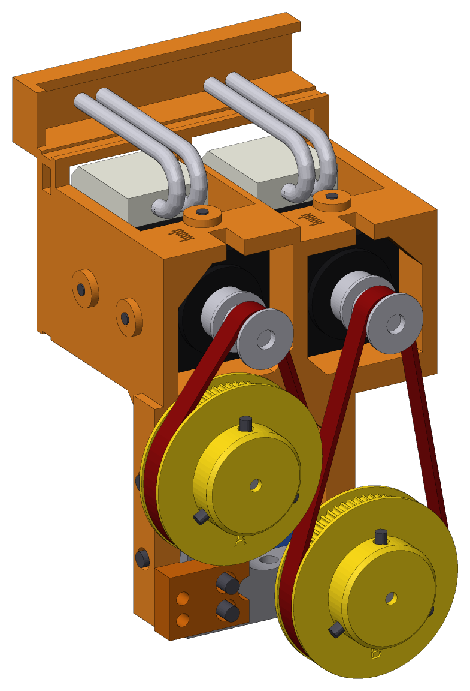

# Motorized mirror mount

Burch Lab, Boston College. Project contact: Cameron Grant (Burch Lab, Room 125).

A 3D-printed attachment that clamps onto a standard kinematic mirror mount (Thorlabs KM100 or KM100T) and drives both adjuster knobs with encoder-equipped NEMA 11 stepper motors through GT2 belts. A controller box (BIGTREETECH SKR Pico) runs the motors; a Python driver on the lab PC commands it, and an alignment routine maximizes the power coupled into an optical fiber.

*The attachment (orange and yellow) on a Thorlabs KM100 mount (grey). The blue plate carries the mirror.*

Fiber coupling requires mirror angles within a few microradians, roughly 1/1000 of a knob turn. Manual alignment is slow and hard to reproduce. The estimate for motorized alignment is under one minute for initial alignment and well under one minute to re-peak after drift.

## Contents

- [Plan](#plan)
- [Repository layout](#repository-layout)
- [Glossary](#glossary)

## Plan

The work is divided into four sequential steps:

| Stage | Scope | Output | Folder |
|---|---|---|---|
| 1 | 3D printing |  | [1-3d-printing](1-3d-printing/README.md) |
| 2 | Fit a Real Mount | Knob caps, base block, rear bar and clip that fit the target mount; logged parameter values | [2-cad-and-fit](2-cad-and-fit/README.md) |
| 3 | Electronics & Purchasing | A checked parts list, ready for approval | [3-parts](3-parts/README.md) |
| 4 | Software & Testing | Motors driven and encoders read from the lab PC | [4-automation](4-automation/README.md) |

## Repository layout

| Path | Contents |
|---|---|
| [1-3d-printing/](1-3d-printing/README.md) | Stage 1 plan |
| [2-cad-and-fit/cad/](2-cad-and-fit/cad/) | OpenSCAD source, v4.1 (files include each other; kept in one folder) |
| [2-cad-and-fit/stl/](2-cad-and-fit/stl/) | Print-ready STLs generated from that source |
| [2-cad-and-fit/mounts/](2-cad-and-fit/mounts/README.md) | Models of the mirror mounts themselves, including the provisional MDI model and its measurement sheet |
| [2-cad-and-fit/cad/extras/](2-cad-and-fit/cad/extras/README.md) | Interference checks |
| [3-parts/](3-parts/README.md) | Parts list and electronics overview (PDF and figures) |
| [4-automation/](4-automation/README.md) | Software overview and SKR Pico quick reference |
| [figures/](figures/README.md) | All rendered figures |

## Glossary

| Term | Definition |
|---|---|
| Kinematic mirror mount | Mirror holder with a fixed back plate and a front plate that tilts on a ball and two adjuster screws; repeatable in angle. Here: Thorlabs KM100, KM100T. |
| Adjuster knob | One of the two knobs on the back of the mount; knob A and knob B tilt the front plate about orthogonal axes. |
| GT2 belt / pulley | Timing belt with 2 mm tooth pitch and matching pulleys. Here: 16-tooth pulley on each motor, printed 66-tooth pulley on each knob cap. |
| Knob cap | Printed part that fits over an adjuster knob, held by three M3 set screws, with a 66-tooth GT2 pulley on its outside. |
| Base block | Main printed part; holds both motors and clamps onto the mount's side leg. |
| Heat-set insert | Knurled brass threaded sleeve melted into a printed hole with a soldering iron. |
| Set screw (grub screw) | Headless screw driven by a hex key; its tip bears on the mating part. |
| Stepper motor | Motor that moves in discrete steps (200 per revolution, or finer with microstepping). Here: NEMA 11, 28 mm frame. |
| Encoder | Sensor on the motor shaft that counts rotation (here 4000 counts per revolution), used to verify motion. |
| SKR Pico | BIGTREETECH controller board (RP2040 plus TMC stepper drivers) used in the controller box. |
| PyBirch | The lab's Python instrument-driver framework; provides `MirrorTiltStage` and `MotionController`. |
